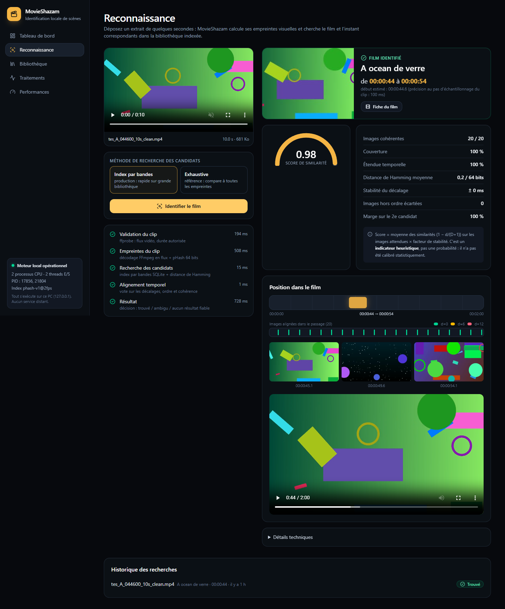

# MovieShazam

**Retrouver le film et l'instant exact d'un extrait vidéo de 5 à 20 secondes**, parmi les films de votre
bibliothèque locale. Moteur Python (FFmpeg + pHash + alignement temporel), interface Next.js en français.

Projet du module *Systèmes distribués et parallèles* (ISAMM 2026–2027) : démonstration de programmation
**parallèle et concurrente sur un seul ordinateur** — `multiprocessing` pour le calcul, `threading` pour les
requêtes, les E/S bloquantes et les travaux de fond (sans asyncio). *Nom provisoire, sans affiliation avec Shazam.*

> **100 % local.** Tout s'exécute sur un seul PC Windows (ou Linux/macOS), sans GPU, sans cloud, sans IA,
> sans worker distant ni socket personnalisée. Le navigateur parle au backend en HTTP sur `127.0.0.1`.



## Ce qui fonctionne réellement

* **Bibliothèque** : import par glisser-déposer (copie en flux + SHA-256 + validation ffprobe), vignettes,
  recherche textuelle, tri, filtre, détail, modification du titre/année, suppression cohérente, réindexation
  **incrémentale** (un fichier inchangé n'est jamais recalculé ; une indexation annulée reprend où elle s'était arrêtée).
* **Indexation parallèle** : film découpé en segments, traités par un `ProcessPoolExecutor` local ; progression
  réelle (segments terminés / total) ; carte des segments colorée par PID du processus qui les a calculés.
* **Reconnaissance** : film, début/fin `HH:MM:SS`, score de similarité expliqué, couverture, Top 3, frise et lecteur
  positionné au bon instant ; « Aucune correspondance suffisamment fiable », « Résultat ambigu » et
  « Clip trop peu informatif » gérés honnêtement.
* **Traitements** : jobs d'indexation / recherche / benchmark, progression, processus utilisés (PID), erreurs,
  annulation coopérative, historique.
* **Performances** : benchmark séquentiel vs 1/2/4 processus sur le même corpus, graphiques (temps, speedup,
  débit, RAM), rappel de l'index par bandes, export CSV/JSON.
* **Tests** : 73 tests automatisés (unitaires, intégration avec de vraies vidéos, bout en bout dans un vrai navigateur).

## Démarrage rapide (Windows)

Prérequis : **Python 3.12** (ou 3.11), **Node.js 20+** (testé avec 24), **FFmpeg**.

```powershell
winget install Python.Python.3.12
winget install OpenJS.NodeJS.LTS
winget install Gyan.FFmpeg            # puis rouvrir le terminal
python --version; node --version; ffmpeg -version

# Depuis la racine du projet : installe tout la première fois, puis démarre backend + frontend
powershell -ExecutionPolicy Bypass -File scripts\start_windows.ps1
```

Le script vérifie les outils, crée `.venv`, installe les dépendances **exactes** (`requirements.txt`,
`frontend/package-lock.json`), construit le frontend, puis ouvre deux fenêtres (backend, frontend) et le
navigateur sur <http://localhost:3000>. Arrêt : Ctrl+C dans chaque fenêtre (arrêt propre du backend).
Linux / macOS : `bash scripts/start_unix.sh`.

## Installation manuelle, pas à pas

```powershell
# 1. Environnement Python reproductible (versions figées)
py -3.12 -m venv .venv
.venv\Scripts\python -m pip install --upgrade pip
.venv\Scripts\python -m pip install -r requirements.txt

# 2. Configuration (facultatif : les valeurs par défaut conviennent)
copy backend\.env.example backend\.env

# 3. Frontend (versions figées par package-lock.json)
cd frontend; npm ci; npm run build; cd ..

# 4. Corpus de démonstration (≈ 2 min, déterministe, libre de droits)
.venv\Scripts\python scripts\generate_demo_videos.py

# 5. Démarrer UN backend et UN frontend
cd backend; ..\.venv\Scripts\python -m uvicorn app.main:app --host 127.0.0.1 --port 8000   # terminal 1
cd frontend; npm run start                                                                # terminal 2
```

La base SQLite (`data/movieshazam.db`) et les dossiers `data/media`, `data/temp` sont créés automatiquement au
démarrage. Documentation interactive de l'API : <http://127.0.0.1:8000/docs>.
**Ne lancez qu'un seul processus Uvicorn** (pas d'option `--workers`) : le parallélisme vient du pool interne.

## Utilisation

1. **Bibliothèque** → déposer les films de `data/demo/movies/` (ou vos propres vidéos légalement détenues).
2. Attendre l'état **Indexé** (progression réelle visible ici et dans **Traitements**).
3. **Reconnaissance** → déposer un clip de `data/demo/clips/` → **Identifier le film**.
   Les noms des clips indiquent la vérité terrain : `tes_A_044600_10s_clean.mp4` = film A, début 44,6 s,
   10 s, réencodage propre. Les clips `E_` et `F_` viennent de films jamais indexés (refus attendu).
4. **Performances** → lancer un benchmark sur les films indexés.

## Tests et contrôle qualité

```powershell
powershell -ExecutionPolicy Bypass -File scripts\check_quality.ps1        # ruff + pytest (rapides) + tsc
powershell -ExecutionPolicy Bypass -File scripts\check_quality.ps1 -All   # + corpus complet + bout en bout

cd backend
..\.venv\Scripts\python -m pytest -q -m "not slow and not e2e"   # ≈ 25 s
..\.venv\Scripts\python -m pytest -q -m slow                     # corpus de démo complet, 2 méthodes
..\.venv\Scripts\python -m pytest -q -m e2e                      # navigateur -> Next.js -> FastAPI (ports 8000/3000 libres, frontend construit)
```

Les tests de décodage et de reconnaissance utilisent de **vraies vidéos générées** (corpus `data/mini` et
`data/demo`, créés automatiquement s'ils manquent). Le test e2e pilote Microsoft Edge via Playwright.

## Évaluation et benchmarks

```powershell
.venv\Scripts\python scripts\evaluate.py --split validation --calibrate   # calibration des seuils (validation seulement)
.venv\Scripts\python scripts\evaluate.py --split test --method both       # évaluation finale
.venv\Scripts\python scripts\run_benchmark.py --repeats 3 --lowres --decode-experiment
```

Rapports : `docs/results/` (JSON, CSV, Markdown). Les benchmarks sont aussi enregistrés dans la base de
l'application et visibles sur la page **Performances**.

## Résultats mesurés (résumé)

Machine : Ryzen 5 5600H (6 cœurs / 12 threads), 8 Go **un seul canal mémoire**, Windows 11. Détail et
interprétation : [`docs/results/RESULTATS.md`](docs/results/RESULTATS.md).

| | |
|---|---|
| Reconnaissance (28 clips de démo) | **12/12** validation, **16/16** test, avec les deux méthodes ; erreur d'horodatage moyenne **8 ms** (tolérance ±1 s) |
| Indexation 720p, 345 s de vidéo | séquentiel 14,6 s · 2 processus 10,5 s (**×1,39**) · 4 processus 11,0 s (×1,32) |
| Même corpus en 480×270 | séquentiel 3,56 s · 2 processus 2,00 s (**×1,77**) · 4 processus 1,46 s (**×2,43**) |
| Empreintes séquentiel vs parallèle | **identiques** dans tous les modes, PID distincts |
| Recherche, index de 500 690 empreintes | bandes 451 ms vs exhaustive 1 338 ms (×3,0), mêmes verdicts |
| Réactivité de l'API pendant une indexation | `GET /api/jobs/{id}` : 4,2 ms en médiane, 10 ms au pire |

À 720p, le décodage HD de plusieurs FFmpeg simultanés plafonne sur cette machine, y compris **sans Python**
(FFmpeg seul : ×1,13 avec 4 copies) : le speedup y est donc limité par le matériel (contention mémoire), pas par
le code. Sur un travail limité par le CPU (480×270), le parallélisme passe bien à l'échelle.

## Architecture

```text
Navigateur (Next.js, :3000) ──HTTP 127.0.0.1──► FastAPI (:8000, un seul processus Uvicorn)
                                                 │  routes `def` exécutées par les threads de FastAPI
                                                 ├─► JobManager (threads) : file bornée des indexations,
                                                 │   2 threads de recherche, thread de benchmark
                                                 ├─► ProcessPoolExecutor (N processus) : segments -> FFmpeg + pHash
                                                 ├─► ThreadPoolExecutor (2 threads) : copie, SHA-256, ffprobe, vignettes
                                                 └─► Thread écrivain unique ─► SQLite (WAL) : films, segments,
                                                                                 empreintes, index par bandes, jobs
```

| Dossier | Contenu |
|---|---|
| `backend/app/video/` | `ffmpeg_io.py` (ffprobe, décodage en flux), `fingerprint.py` (pHash, Hamming), `segmentation.py`, `pipeline.py` (fonction métier unique), `matching.py` (vote, alignement, score, décision) |
| `backend/app/concurrency/` | `process_pool.py`, `thread_io.py`, `job_manager.py` (threads de fond) |
| `backend/app/db/` | modèles SQLAlchemy, sessions, `writer.py` (écrivain unique), `repo.py`, `search_repo.py` (bandes / exhaustive) |
| `backend/app/services/` | `library.py`, `indexing.py`, `searching.py`, `benchmark.py` |
| `backend/app/api/` | routes REST + schémas Pydantic |
| `backend/tests/` | 73 tests pytest |
| `frontend/` | Next.js App Router + TypeScript + Tailwind (5 pages + détail film) |
| `scripts/` | générateur de corpus, évaluation, benchmark, démarrage Windows/Unix, contrôle qualité |
| `docs/` | `CONCURRENCY_EXPLAINED.md`, `DEMO_SOUTENANCE.md`, `PLAN_PRESENTATION.md`, `results/`, guide PDF |

## Configuration

Voir [`backend/.env.example`](backend/.env.example). Principaux réglages : `PROCESS_WORKERS=2`, `IO_THREADS=2`,
`FINGERPRINT_FPS=2`, `SEGMENT_DURATION_SECONDS=180` (maximum), `MAX_ACTIVE_INDEX_JOBS=1`,
`MAX_QUERY_DURATION_SECONDS=30`, `MAX_UPLOAD_GB=8`. Changer `FINGERPRINT_FPS` crée une nouvelle version d'index
(les anciens index ne sont jamais mélangés).

## Choix de conception assumés (écarts raisonnés au cahier des charges)

* **Pas d'asyncio dans le code de l'application** : le cahier des charges proposait asyncio pour
  coordonner ; nous utilisons uniquement des processus (calcul) et des threads (requêtes, E/S, travaux de
  fond). Avec quelques requêtes et quelques jobs simultanés, des threads suffisent et sont plus simples à
  expliquer et à tester. Les routes sont des fonctions `def` (FastAPI les exécute dans son pool de
  threads), le démarrage et l'arrêt des gestionnaires `on_startup` / `on_shutdown` synchrones, et la
  limite de taille des envois est assurée par le middleware de Starlette. Uvicorn garde en interne sa
  propre boucle d'événements pour les sockets ; l'application n'y touche pas. Un test le vérifie
  (`test_application_code_does_not_use_asyncio`).

* **Clip échantillonné 5× plus finement que l'index** (10 img/s contre 2), avec exactement le même pHash : un clip
  peut commencer entre deux images indexées ; sans cela, les scènes rapides n'étaient plus reconnues.
* **Longueur de segment adaptative** (10 à 180 s, au moins 8 segments par film) pour que les films courts
  bénéficient aussi du parallélisme ; le découpage ne dépend pas du nombre de processus.
* **Empreintes du clip calculées dans un thread** (le décodage est fait par un sous-processus FFmpeg) plutôt que dans
  le pool, pour ne pas attendre derrière les segments d'indexation.
* **Pas de `MAX_FFMPEG_CONCURRENT`** : le nombre de FFmpeg est borné structurellement (un par processus du pool, un
  par thread E/S) ; un sémaphore supplémentaire serait redondant.
* `stored_name` relatif au lieu d'un chemin absolu ; empreintes en BLOB de 8 octets ; seuils calibrés sur un split
  de validation distinct du test.

## Limites connues

* Pas de reconnaissance garantie après gros recadrage, incrustations importantes, miroir, accélération ou écran
  filmé au téléphone (hors périmètre V1). L'audio n'est pas utilisé.
* Le score est un **indicateur heuristique**, pas une probabilité calibrée.
* Le corpus de validation est synthétique et petit (28 clips) : les seuils devront être revérifiés sur de vrais films.
* Mesures « à froid » non réalisées (vider le cache disque de Windows exige des droits administrateur) : toutes les
  mesures sont « à chaud ».
* Pas de reprise automatique après une panne système complète : les jobs interrompus sont marqués comme tels au
  redémarrage, et une réindexation reprend à partir des segments déjà terminés.
* Machine de développement : 8 Go de RAM (et non 16) ; fermer les applications lourdes pendant les démonstrations.

## Documentation

* [`docs/CONCURRENCY_EXPLAINED.md`](docs/CONCURRENCY_EXPLAINED.md) — chaque technique du cours, le problème résolu, le code, la preuve.
* [`docs/DEMO_SOUTENANCE.md`](docs/DEMO_SOUTENANCE.md) — déroulé de la démonstration sur un seul PC.
* [`docs/PLAN_PRESENTATION.md`](docs/PLAN_PRESENTATION.md) — plan des slides avec notes orales.
* [`docs/results/RESULTATS.md`](docs/results/RESULTATS.md) — toutes les mesures.
* `docs/MovieShazam_Guide_Zero_to_Hero.pdf` — guide pédagogique complet (en anglais), de zéro à expert.
